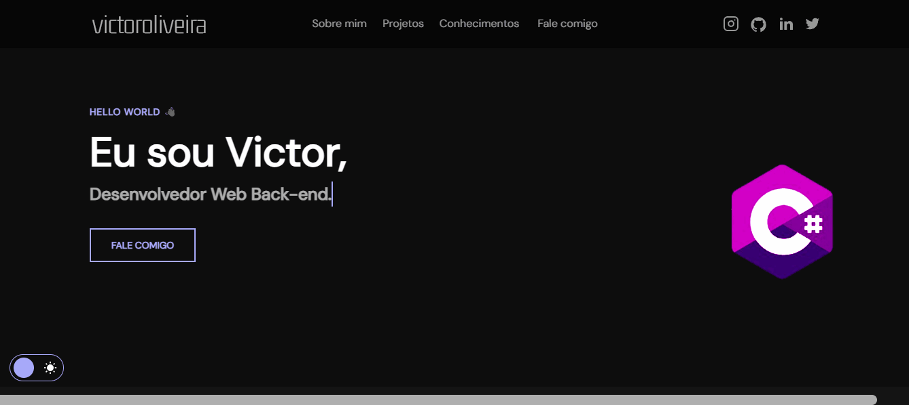

<h1 >Portifólio - Victor 💻</h1>

<h4 ><a href="">Confira o projeto aqui</a></h4>

---

## 💻 Sobre

Projeto feito no intuito de me apresentar, como desenvolvedor web back-end.

## 🤯 O site é composto por:

- **Home:** Minha apresentação;
- **Sobre mim:** Falo um pouco sobre minha trajetória e meu estado atual;
- **Projetos:** Alguns projetos recentes que fiz;
- **Conhecimentos:** As tecnologias que tenho conhecimento;
- **Fale comigo:** Área com meios para contato comigo;
- **Redes:** Minhas redes sociais disponíveis no menu de navegação e no rodapé do site.

## 🧠 Tecnologias utilizadas:

O site **ainda está em desenvolvimento**. Mas até aqui utilizei as tecnologias:

    
    
    

## 📚 Alguns conceitos aplicados

Neste projeto apliquei os seguintes pontos:
+ Semântica HTML;
+ Pontos de acessibilidade;
+ Responsividade;
+ Mobile first;
+ Utilização da lib JS <a href="https://scrollrevealjs.org">Scroll Reveal</a>.

---

<table>
  <tr>
    <td>
      
    </td>
    <td>
      Feito por <a href="https://github.com/victoroliveira59">Victor Oliveira</a> 🙋🏿‍♂️
    </td>
  </tr>
</table>

## 🏆 Licença

The [MIT License](./LICENSE).
